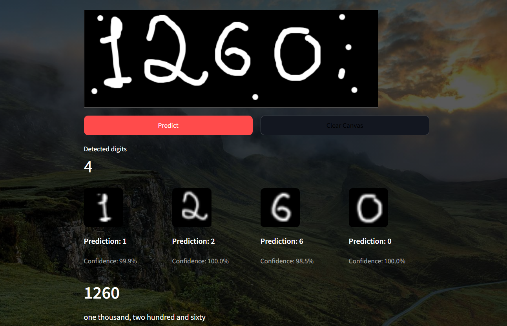
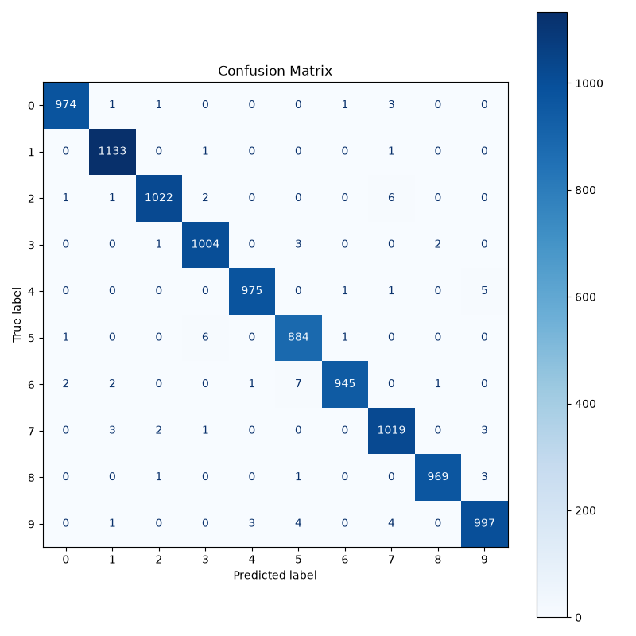
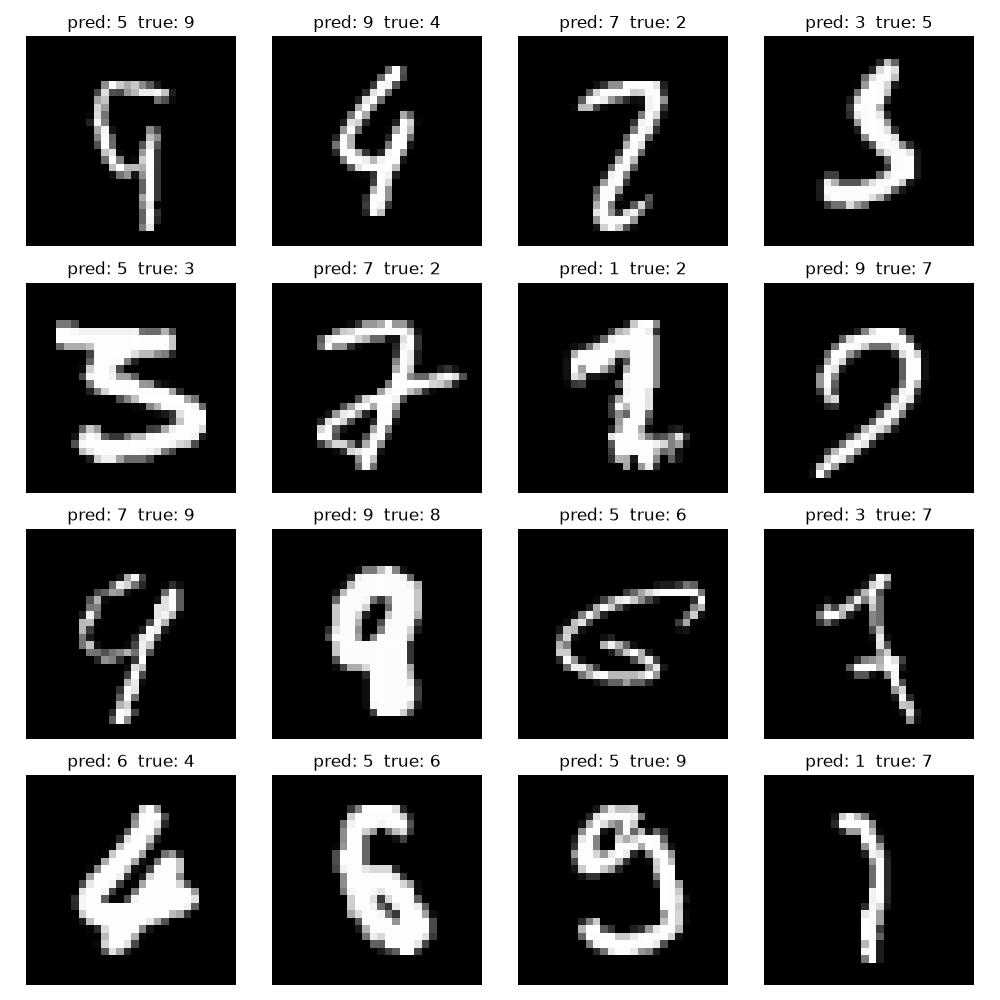
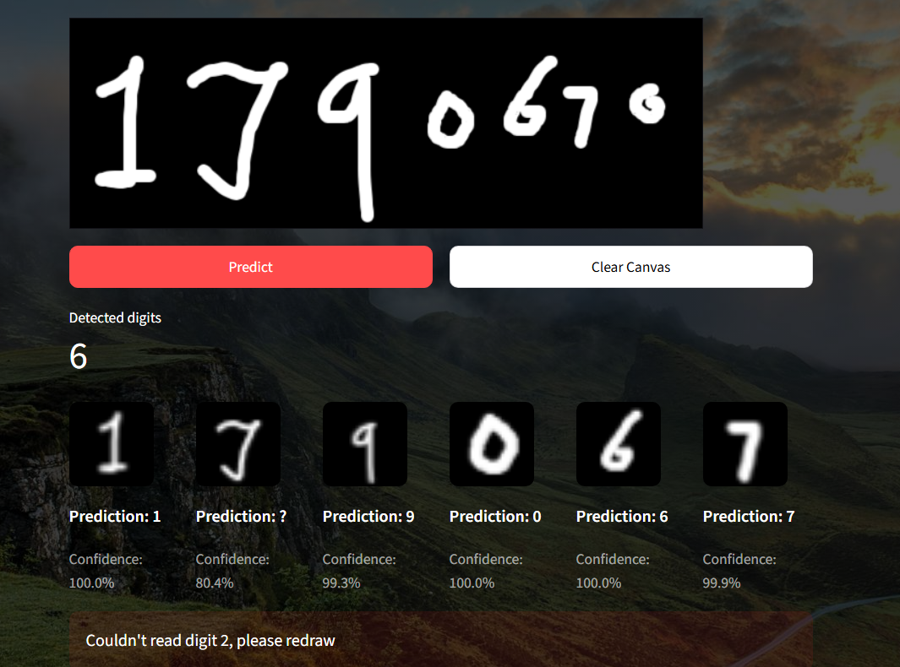

# Multi-Digit Handwritten Number Recognizer

A web application that segments, preprocesses, and classifies multi-digit handwritten sequences from an interactive canvas using a PyTorch CNN.

## 🚀 Live Demo

[Click here to try the live application](https://digitrecognisermnistcnnbyraj-khq83tavusvv2kfcw4ncjd.streamlit.app/)

## 📸 App Screenshot



---

## ⚙️ How It Works

1. **Canvas Ingestion:** Extracts drawing canvas data, handles RGB/RGBA conversion, and normalizes foreground ink to white on a black background.

2. **Segmentation:** Applies Otsu's thresholding and 8-connectivity connected component analysis (`cv2.connectedComponentsWithStats`) to detect individual digit blobs.

3. **Filtering & Sorting:** Discards noise blobs (area < 50 px, height < 24 px) and sorts remaining digits from left to right by their horizontal bounding box coordinate.

4. **MNIST Preprocessing:** Pads each blob to a square, resizes it to 20x20 (`cv2.INTER_AREA`), embeds it in a 28x28 black canvas, and translates it using `scipy.ndimage.center_of_mass` so the intensity center aligns with `(14.0, 14.0)`.

5. **Inference & Safety Rules:**
   - Blobs with an aspect ratio (width / height) > 1.6 trigger a warning: **"Leave a gap between digits"**.
   - Each crop is evaluated by the CNN.
   - If any digit has a softmax confidence below 95%, it is flagged as `?`, and the full number output is suppressed.

6. **Output:** If all digits pass the confidence threshold, they are joined into the final number and verbalized using `num2words`.

---

## 🧠 Model and Results

The classification model is a Convolutional Neural Network (CNN) trained on the standard MNIST dataset, achieving approximately **99.2% test accuracy** as part of an MIT edX course.

### Model Architecture

```text
Conv2d(1, 32, 3)
    -> ReLU
    -> MaxPool2d(2)
    -> Conv2d(32, 64, 3)
    -> ReLU
    -> MaxPool2d(2)
    -> Flatten
    -> Linear(1600, 128)
    -> Dropout(0.5)
    -> Linear(128, 10)
```

---

## 📊 Evaluation & Failure Analysis

| Confusion Matrix(Training Run) | Misclassified Digits(Training Run) | Failure Cases(Live App) |
|:---:|:---:|:---:|
|  |  |  |

---

## 📁 Repository Structure

```text
├── streamlit_app.py
├── src/
│   ├── model.py
│   ├── segmentation.py
│   ├── preprocessing.py
│   └── utils.py
├── models/
│   └── mnist_cnn_weights.pt
├── docs/
│   ├── app_screenshot.png
│   ├── confusion_matrix.png
│   ├── misclassified.png
│   └── failure_cases.png
└── requirements.txt
└── Nature.png
└── .streamlit/
      └── config.toml
```

---

## 💻 Run Locally

### 1. Clone the Repository

```bash
git clone https://github.com/your-username/mnist-multidigit-recognizer.git
cd mnist-multidigit-recognizer
```

### 2. Create and Activate a Virtual Environment

```bash
python -m venv venv
```

**macOS / Linux:**

```bash
source venv/bin/activate
```

**Windows:**

```bash
venv\Scripts\activate
```

### 3. Install Dependencies

```bash
pip install -r requirements.txt
```

### 4. Launch the Application

```bash
streamlit run streamlit_app.py
```

The application will be available at:

```text
http://localhost:8501
```

---

## ⚠️ Known Limitations

- **Touching/Overlapping Digits:** Digits written without sufficient spacing merge into a single connected component and cannot be split reliably.

- **Disconnected Strokes:** Digits drawn in multiple disconnected parts (e.g., a detached top bar on a "5") may be segmented as separate blobs or filtered out as noise.

- **Scale Variance:** Excessively small digits or extreme size differences across strokes can be discarded by the minimum area and height filters.

---

## 🛠️ Tech Stack

- **Framework:** Streamlit
- **Deep Learning:** PyTorch (CPU-only)
- **Computer Vision & Image Processing:** OpenCV (`opencv-python-headless`), SciPy, NumPy
- **Interactive Component:** `streamlit-drawable-canvas`
- **Text Conversion:** `num2words`
- **Hosting:** Streamlit Community Cloud

---

## 🙏 Credits

- **MNIST Dataset:** Yann LeCun, Corinna Cortes, and Christopher J.C. Burges.
- **CNN Model:** Model training and architecture adapted from the MIT edX course (6.86x / Machine Learning with Python).

---

**Built with Python, PyTorch, and Streamlit.**
